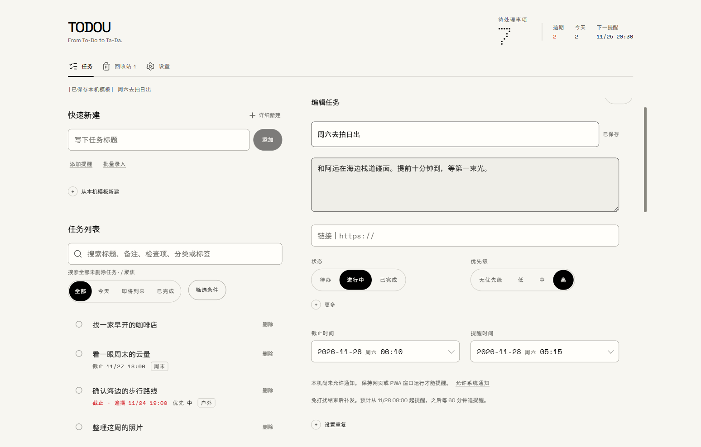
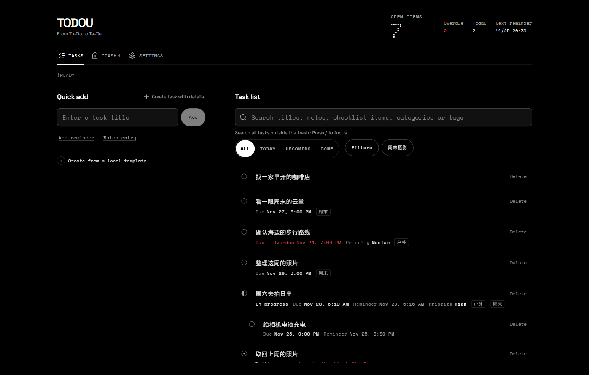
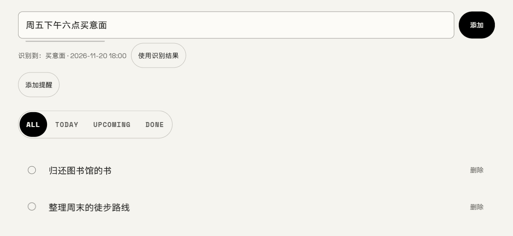

<div align="center">
  
  <h1>ToDou · Web / PWA</h1>
  <p><strong>From To-Do to Ta-Da.</strong></p>
  <p>本地优先、离线可用的个人待办工作台。<br />全部任务保存在浏览器本地 SQLite 数据库中，无需注册账号；需要多端共用时，由设备直连你自己的 OneDrive 或 WebDAV。</p>

  <p>
    <a href="https://github.com/AllenLensu/ToDou/releases/tag/1.7.5"></a>
    
    
    
  </p>

  <p>
    <a href="#上手与安装">上手与安装</a> ·
    <a href="#日常使用">日常使用</a> ·
    <a href="#键盘快捷键">键盘快捷键</a> ·
    <a href="#备份与多端同步">备份与多端同步</a> ·
    <a href="#本地运行与部署">本地运行与部署</a>
  </p>
</div>

---

<video src="assets/promo/ToDou.mp4" poster="assets/promo/overview/cover.jpg" controls width="100%"></video>

<p align="center">
  <a href="assets/promo/ToDou.mp4">《周六去拍日出》</a> ·
  <a href="assets/promo/overview/DESIGN.md#分镜">分镜时间表</a>
</p>

<table>
  <thead>
    <tr>
      <th width="50%">浅色主题（中文界面）</th>
      <th width="50%">OLED 纯黑暗色主题（英文界面）</th>
    </tr>
  </thead>
  <tbody>
    <tr>
      <td></td>
      <td></td>
    </tr>
  </tbody>
</table>

## 上手与安装

当前正式版为 **ToDou 1.7.5**（内部构建号 `1795712220`，发布标签 `v1.7.5`）。自托管可前往 [发行版 v1.7.5](https://github.com/AllenLensu/ToDou/releases/tag/1.7.5) 下载 `ToDou-v1.7.5-web.zip` 与对应的 `.sha256` 校验文件。

| 使用方式 | 操作说明 |
| --- | --- |
| **浏览器直接使用** | 打开部署好的 ToDou 站点即可记事。首次访问按浏览器语言偏好自动选择中文或英文（不匹配时默认中文），后续可在「设置」顶部随时切换语言与明暗主题。 |
| **安装为独立 PWA** | 先联网打开一次，在「设置 → 离线启动」确认状态显示「已可离线打开」（若下载中断可点「重试离线缓存」），再通过浏览器地址栏或菜单安装到桌面或手机主屏幕。装好后断网也能照常打开和修改原有清单。 |
| **升级已有站点** | 升级前建议先在「设置 → 数据与备份」导出一份 `.todou.json`，再将新版静态文件覆盖到原站点根目录。多设备共用同一份清单时，请等各端都升到 `1.2` 或以上版本再使用永久删除功能。 |

> [!NOTE]
> 网页版的到点提醒依赖保持运行的标签页或已安装的 PWA 窗口：打开任务的「提醒细则」，开启本机提醒并允许浏览器发送系统通知即可，弹窗表现随浏览器与操作系统通知设置而定。

---

## 日常使用

### 快速录入与自然语言时间识别



- **单条与批量录入**：在顶部「快速新建」输入标题按 `Enter` 即可保存，向下滚动列表时录入区会停留在原位。手头有一串待办时，点「批量录入」每行写一项，勾好要创建的任务与提醒再一并保存。
- **日期时间识别**：除了点「添加提醒」手选时间，直接输入「周五下午六点买意面」并点「使用识别结果」，标题会留作「买意面」，提醒自动设在周五 `18:00`。若只写「周五买意面」这类不含具体钟点的句子，补选时间即可；不想拆分时间时直接按 `Enter` 会按原文保存。
- **自动保存与草稿守卫**：点开已有任务修改备注、检查项、截止时间或提醒时间后会自动落盘；新建草稿或未保存改动在切换视图前会弹出保留或放弃确认，避免误丢内容。

### 视图、搜索与日程导出

- **自然日日程视图**：日常用「今天」和「即将」排手头的事。「即将」顶部列出未来七天每天的事项数，点击有安排的日期可直接跳到当天第一项；点击「复制当前日程」可把筛好的「今天」或「即将」复制成带时间的 Markdown 勾选清单。
- **全文检索与预设筛选**：按 `/` 聚焦搜索框，可同时检索任务标题、备注、检查项内容、分类名和标签名。常看的视图和过滤组合可在「筛选条件」里命名并点「存为新筛选」，下次一键回到当时的列表。

### 层级、检查项与关联任务

- **子任务与步骤拆分**：需要分开跟进的事项可拆成子任务；同一件事里的具体步骤可列成检查项，每一步都能单独写备注、勾选完成或编辑提醒时间。
- **检查项独立提醒**：带提醒时间的检查项即使所属父任务没有设日期，也会自己进入「今天」或「即将」。父任务暂停或取消后，底下的检查项提醒会跟着暂停；完成父任务时若选「仅完成父任务」，尚未勾选的检查项会继续按时提醒。
- **任务关联跳转**：在详情「层级与关联」输入标题即可筛选并关联其他任务。点击旁边的「打开」跳转前会先保存当前草稿；若保存失败则留在原任务里，防止丢字。

### 自动重复与本机模板

- **固定日历与按完成日重复**：在「层级与关联」选好重复依据、间隔与单位后点「启用自动重复」。按固定日历重复支持指定工作日或每周固定的几天，可设截止日期或总次数，并提前铺出未来七天的期次；按实际完成日重复则在本期完成后再计算下一期。往期记录完整保留，改期时可选只改「仅此次」或连同「此次及以后」一并顺延。
- **检查项重复节奏**：检查项选「跟随所属任务」会在新一期重置为未完成；若某个步骤有独立周期，先设好提醒时间再选「独立重复」即可启用（旧版留下的自由文本规则会保留原文，未点启用前仍按手动方式创建下一期）。
- **本机流程模板**：常用流程可在任务详情存为本机模板。新建时挑选基准日期，即可预览截止时间、提醒时间和各条检查项的顺延时刻，核对无误后创建独立任务。

### 提醒、分类维护与历史差异恢复

- **分级追提醒间隔**：提醒弹出后暂时腾不出手时，点「知道了」可先收起当次提示，后续按追提醒间隔再次提醒。全局间隔在「设置 → 本机提醒」配置，分类可单独覆盖，单条任务也能在「提醒细则」设定独立节奏。
- **分类、标签与回收站**：分类和标签支持在设置中改名；删除标签只会从相关任务上摘除标记，不影响任务与历史。误删任务可从回收站恢复，确认点「永久删除」才会彻底清除（超过 99 项时导航角标显示 `99+` 并保留准确读屏计数）。
- **字段级历史恢复**：改乱内容想回退时，打开任务历史点「查看恢复差异」，核对将要还原的字段差异后再确认恢复。
- **界面层级与无障碍**：顶栏下方状态行按优先级呈现报错、可撤销操作反馈与编辑保存状态（窄屏空闲时自动收起留出首屏空间）；任务详情与设置面板的折叠分组均带展开箭头与实时摘要；全界面满足 WCAG 2.1 AA 对比度、键盘焦点环、弹窗焦点锁定与屏幕阅读器语义要求，六种列表空态配有随明暗主题切换的单色线条插图。

---

## 键盘快捷键

| 按键 | 作用 |
| --- | --- |
| <kbd>/</kbd> | 聚焦任务搜索框 |
| <kbd>N</kbd> | 聚焦顶部「快速新建」输入框（非回收站视图） |
| <kbd>↑</kbd> / <kbd>↓</kbd> | 在任务列表内上下切换选中项 |
| <kbd>Enter</kbd> | 打开当前聚焦的任务详情或提交快速新建 |
| <kbd>X</kbd> | 切换当前选中任务的完成状态 |
| <kbd>Ctrl</kbd>+<kbd>S</kbd> / <kbd>Cmd</kbd>+<kbd>S</kbd> | 立即保存当前正在编辑的任务草稿 |
| <kbd>Esc</kbd> | 依次关闭日期选择器、确认弹层或返回列表焦点 |

> [!TIP]
> 如果你使用语音输入、屏幕阅读器或其他单键辅助工具，可以在「设置 → 单键快捷键」中关闭 <kbd>/</kbd>、<kbd>N</kbd>、<kbd>X</kbd> 三个单字符快捷键；关闭后方向键、<kbd>Esc</kbd> 与 <kbd>Ctrl/Cmd</kbd>+<kbd>S</kbd> 仍照常工作。

---

## 备份与多端同步

ToDou 三端各自维护设备本地的 SQLite 数据库，不设中间账号或中转服务器；多设备同步通过你自己的网盘应用目录或 WebDAV 目录直接交换字段级增量。`1.7.5` 继续使用 SQLite `schema 8`，向下兼容导入 `schema 6` 与 `schema 7` 的历史备份文件。

| 项目 | 机制说明 |
| --- | --- |
| **本地数据库** | Web / PWA 使用 SQLite WASM，Windows 与 Android 使用各自的原生 SQLite。同一浏览器访问同一地址即可直接打开原有清单；清理站点数据或更换浏览器前请先导出 `.todou.json`。 |
| **手动导入导出** | 「设置 → 数据与备份」支持导出 `.todou.json`。导入前先展示任务与检查项数量预览；确认替换前会自动留存一份当前数据库的本机副本，并暂停本机自动同步，避免误冲掉其他设备的修改。 |
| **定期独立备份** | 默认每天自动备份一次，在打开应用或切回前台时检查是否到期；支持存往本机、独立 WebDAV 目录或两处同时保存。自动副本在本机保留最近 `3` 份、在 WebDAV 按设备保留最近 `10` 份；手动备份保留至主动删除。 |
| **逐设备网盘授权** | 在「设置 → 网盘同步 → 网盘连接」登录个人或工作/学校 OneDrive，或配置同一个 WebDAV 目录（网页直连 WebDAV 需服务端放行当前站点 `CORS`）。账号令牌与密码只留在当前设备本地，绝不写入同步文件或导出包。 |
| **字段级合并与冲突** | 离线改动照常落盘。一端改标题、另一端改备注，联网后按字段自动合并；仅当同一字段在同一时刻被改成不同内容时，才交由你手动选择保留版本。网盘同步出错时，任务页和回收站会弹出浮层提示。 |
| **同步频率档位** | 新连接默认每 `5` 分钟同步一次，可改为 `1`、`15`、`30`、`60` 分钟或手动（旧版升级保留原间隔）。选 `1` 分钟档时每次保存后立即上传；手动档仅在打开应用、恢复联网或点击「立即同步」时交换改动。「查看待上传明细」可按任务核对待传改动数。 |
| **跨设备整体恢复** | 在某台设备恢复备份后，若希望其他设备也整库切换到这份快照，可在来源设备的「网盘同步 → 跨设备整体恢复」预览并发布；其余设备收到后均会先弹出替换范围，逐台确认后才各自留好本机副本并换上新快照。 |

已安装 PWA 与另一浏览器窗口通过个人 OneDrive 交换离线改动的实测证据见 [Web / PWA 技术与验收记录](WEB-PWA.md)。

---

## 本地运行与部署

### 本地开发与测试

准备 **Node.js 24.x**（`24.12` 及以上）和 `npm`，在仓库根目录执行以下命令即可在本机启动带完整离线缓存的预览服务：

```powershell
npm ci
npm run build
npm run host
```

启动后在浏览器访问 `http://127.0.0.1:5050`。局域网内的其他电脑或手机也可通过 `http://主机IP:5050` 访问调试（浏览器按访问源隔离本地存储，日常使用请固定同一浏览器与同一地址）。

| 常用命令 | 用途 |
| --- | --- |
| `npm run dev` | 启动 Vite 开发热更新服务 |
| `npm test` | 运行本地存储、PWA、提醒、界面与同步回归测试套件（需包含 `tests/` 目录） |
| `npm run test:windows-sync` | 联合相邻目录的 `ToDouWindows` 运行跨引擎 SQLite 双向互通回归（非相邻路径用 `TODOU_WINDOWS_ROOT` 指定） |
| `npm run package:release` | 在干净 Git 提交与生产构建完成后生成 `releases/ToDou-v1.7.5-web.zip` 及 SHA-256 清单 |

### 生产环境 HTTPS 与 Nginx 部署

离线重开已安装 PWA、浏览器系统通知以及 OneDrive 登录回调均受浏览器安全上下文约束，线上部署需使用 **HTTPS**（本机调试可使用 `127.0.0.1` / `localhost`）。默认构建内置了 ToDou 的 Microsoft Entra 应用注册；自托管站点若需改用自有应用注册，将站点根地址配置为单页应用（SPA）回调地址，并在编译时传入环境变量 `VITE_ONEDRIVE_CLIENT_ID` 即可。

将发行版中的 `ToDou-v1.7.5-web.zip` 解压到 HTTPS 站点根目录（自行编译则上传 `dist/web/` 下的全部文件）。SQLite WASM 依赖跨源隔离响应头与 `.wasm` MIME 类型，Nginx 配置可参考下方示例：

```nginx
root /var/www/todou;
add_header Cross-Origin-Opener-Policy "same-origin" always;
add_header Cross-Origin-Embedder-Policy "require-corp" always;

index index.html;
error_page 404 /404.html;
location / {
    try_files $uri $uri/ =404;
}

location ~ \.wasm$ {
    types { application/wasm wasm; }
    try_files $uri =404;
}
```
